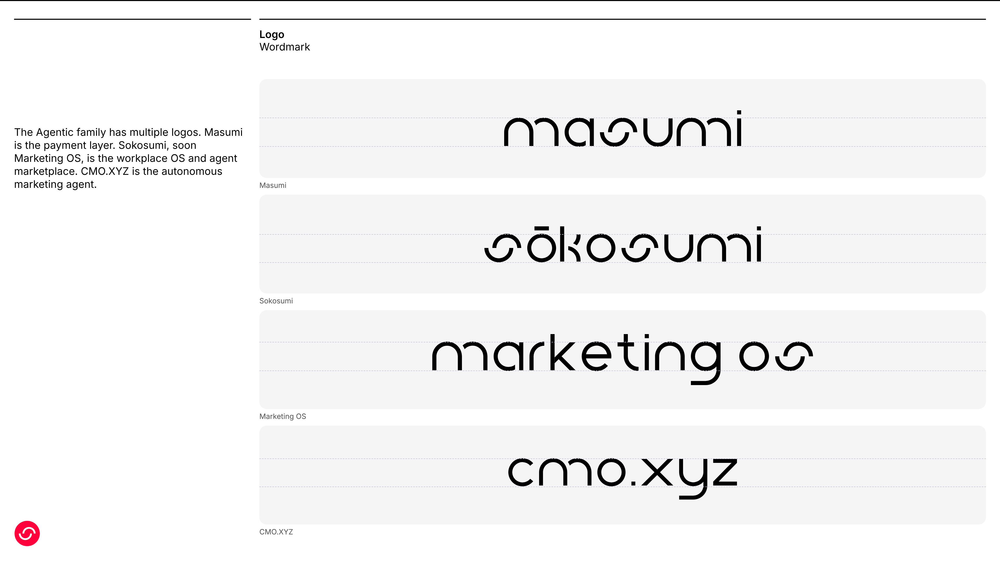
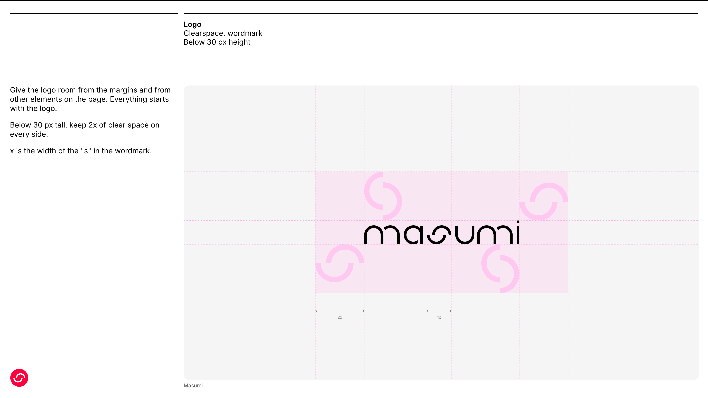
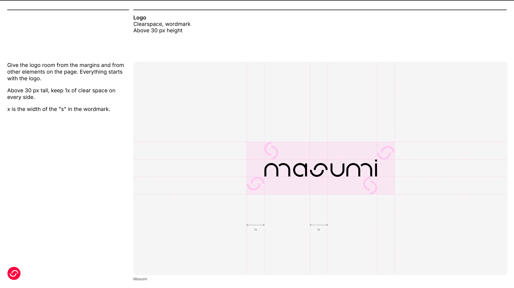
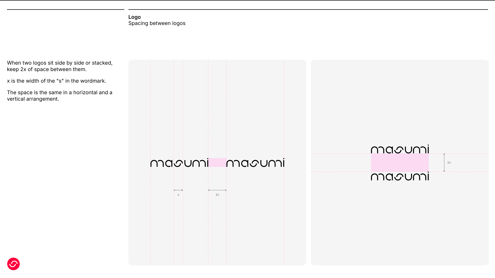
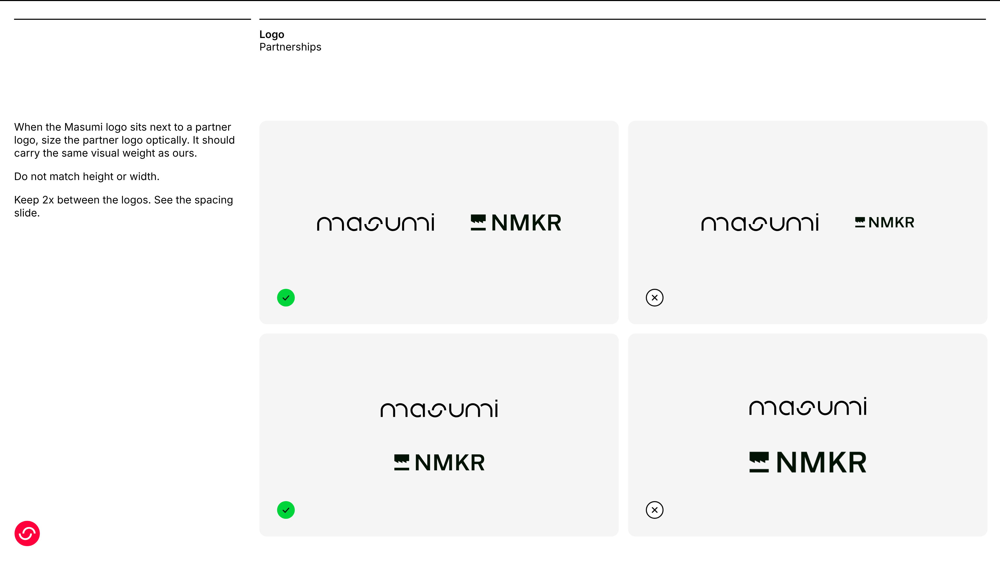

# Masumi family

> **Disclaimer: names will change.** Some product names in this guide are being renamed. This file uses the current names until the changes go live. This document will reflect the changes when they are approved and live.
>
> | Current name | New name |
> |---|---|
> | Sokosumi | Marketing OS |
> | Masumi Protocol (the smart contract) | Masumi Standard |
> | Masumi Payment Service | Masumi Agent Wallet |
>
> Brand rules (logo, color, type, UI/UX) carry over to the new names. Wordmarks for both Sokosumi and Marketing OS are in `logos/`. Wordmarks for Masumi Standard and Masumi Agent Wallet are **Open**.

## Overview

This is the single source of truth for brand and UI/UX across **Masumi**, **Sokosumi**, and **CMO.XYZ**.

- Designers, developers, and the website team build from this file.
- **Do not build against anything marked Open as final.**

### The three brands

- **Masumi** is the payment layer and the backend that powers Sokosumi.
- **Sokosumi** is the workplace OS and agent marketplace.
- **CMO.XYZ** is an autonomous marketing agent that runs on top of Sokosumi and Masumi.

All three share one palette, one graphic language, and one set of UI/UX rules (Section 5), built on shadcn/ui, Tailwind, and Radix. All three use the Masumi typeface, Inter, and the Masumi color palette, with Iris Flower as the primary. CMO.XYZ is the only brand with a mascot and a named agent persona.

### The Agentic family

The Agentic family has multiple logos. Masumi is the payment layer, Sokosumi is the workplace OS and agent marketplace, and CMO.XYZ is the autonomous marketing agent. Marketing OS is the upcoming name for Sokosumi. The slide follows this guide: Inter, the shared neutrals, the xl radius, and black logos only. The dashed lines mark each wordmark's x-height and baseline.



| Brand | Role | Logo |
|---|---|---|
| Masumi | Payment layer |  |
| Sokosumi | Workplace OS and agent marketplace |  |
| Marketing OS | Upcoming name for Sokosumi |  |
| CMO.XYZ | Autonomous marketing agent |  |

The slide is `logos/agentic-family-slide.png` (16:9, 1920 by 1080 at 2x). Its editable source is `agentic-family-slide.html`.

### Telling the brands apart

With one shared palette, color does not separate the brands. These do:
- **Wordmark:** each brand has its own logo.
- **Mascot and agent persona:** Cuso belongs to CMO.XYZ only.
- **Density and surface:** Sokosumi is a dense, neutral-heavy team workspace. CMO.XYZ is lighter and more open.

### Status legend

| Label | Meaning |
|---|---|
| Locked | Decided. Build against it. |
| Working | In use, not final. Do not treat as final. |
| Open | Decision needed. Do not build against it. |
| Proposed | A default suggested by this draft. Needs approval. |

### Status at a glance

| Area | Masumi | Sokosumi | CMO.XYZ |
|---|---|---|---|
| Positioning | Locked | Locked | Locked |
| Voice and tone | TBD (Section 6.5) | TBD (Section 6.5) | Locked |
| Typeface | Locked (Inter) | Locked (Inter) | Locked (Inter) |
| Color palette | Locked (shared) | Locked (shared) | Locked (shared) |
| Logo | Locked | Locked | Working (current wordmark) |
| Graphic language | None set (gradients, mockups) | None set (gradients, mockups) | None set (gradients, mockups) |
| Mascot and avatars | Not applicable | Not applicable | Working |
| Dark mode | Locked, values open | Locked, values open | Locked, values open |
| Imagery, motion, templates, co-branding | TBD | TBD | TBD |
| UI/UX rules | Locked (shadcn/ui) | Locked (shadcn/ui) | Locked (shadcn/ui) |

### Naming rules

- Logos are lowercase: masumi, sokosumi, marketing os. In writing, brand names are capitalized like proper nouns: Masumi, Sokosumi, Marketing OS.
- The product name is written **CMO.XYZ** in capitals.
- Never abbreviate a brand name or add a suffix to it.

---

## 1. Masumi

### Role and personality

Masumi is the payment layer. It is the foundation the other products stand on, so it should feel precise, calm, and trustworthy, with warmth from its color.

### Logo

- **Wordmark.** Each brand has a wordmark. The symbol is a separate mark for small spaces.
- **Minimum size.** Wordmark: 14px tall on screen. The print minimum is **Open**.
- **Clearspace.** Keep clear space on all four sides of the wordmark. x is the width of the "s" in the wordmark. Below 30 px tall: 2x. Above 30 px tall: 1x. See Logo clearspace below.
- **On color.** On any colored or multicolored background, use black or white only.
- **Symbol.** Use the symbol only where there is no room for the full wordmark, and never when several brand symbols appear together.
- **In running text.** Write the brand name in the body typeface, in the same weight as the copy.
- **Placement.** Nine placements are allowed inside a defined space: center, top, or bottom on each axis.
- **Partnerships.** Use horizontal or vertical arrangements with the wordmark only. Size partner logos optically. Do not match their height or width to ours. See Logo spacing and Logo partnerships below.

### Logo clearspace

Nothing enters the clear space around the wordmark: no text, no other logos, no page edge. The rule is shown on the Masumi wordmark. How x is measured on the Sokosumi, Marketing OS and CMO.XYZ wordmarks is **Open**.

| Wordmark height | Clear space |
|---|---|
| Below 30 px | 2x |
| Above 30 px | 1x |





The slides are in `logos/`. Their editable source is `logo-clearspace-slide.html`. Open it with `#1` or `#2` at the end of the address for the 1x or 2x version.

### Logo spacing

When two logos sit side by side or stacked, keep 2x of space between them. x is the width of the "s" in the wordmark. The space is the same in a horizontal and a vertical arrangement. **Proposed:** the 2x value is measured from the spacing in the original partnerships slide. Confirm it.



The editable source is `logo-spacing-slide.html`.

### Logo partnerships

When the Masumi logo sits next to a partner logo, size the partner logo optically so it carries the same visual weight as ours. Do not match height or width. Use a horizontal or vertical arrangement with the wordmark only.



- **Correct (green check).** The partner logo is sized to look equal in weight to the wordmark, in a horizontal or a vertical arrangement.
- **Incorrect (x).** The partner logo is too small, or it is enlarged to match the width of the wordmark.
- The example partner logo is NMKR, taken from the original Agentic brand guidelines (`logos/partners/nmkr-logo.png`). The editable source is `logo-partnerships-slide.html`.

### Logo files

All files are in the `logos/` folder next to this file, one subfolder per brand. Black versions are for light backgrounds. White versions are for dark and colored backgrounds.

| Brand | File | Use |
|---|---|---|
| Masumi | `logos/masumi/masumi-symbol.svg` | Symbol. Favicon and avatar. |
| Masumi | `logos/masumi/masumi-logo-wordmark-black.svg` | Wordmark, black |
| Masumi | `logos/masumi/masumi-logo-wordmark-white.png` | Wordmark, white (PNG, no SVG yet) |
| Sokosumi | `logos/sokosumi/sokosumi-logo-wordmark-black.svg` | Wordmark, black |
| Sokosumi | `logos/sokosumi/sokosumi-logo-wordmark-white.svg` | Wordmark, white |
| Marketing OS | `logos/marketing-os/marketing-os-wordmark-black.svg` | Wordmark, black |
| Marketing OS | `logos/marketing-os/marketing-os-wordmark-white.svg` | Wordmark, white |
| CMO.XYZ | `logos/cmo-xyz/cmo-xyz-wordmark-black.svg` | Wordmark, black |
| CMO.XYZ | `logos/cmo-xyz/cmo-xyz-wordmark-white.svg` | Wordmark, white |

- **Symbol color.** The symbol file uses red `#FF003D`. This red is a logo color, not a palette color. The palette primary is Iris Flower `#FF51FF`.
- **Proportions.** The wordmark is about 6.5 to 1 (width to height).
- **Do not** recolor, outline, stretch, rotate, or add effects to any logo file.
- Marketing OS is the upcoming name for Sokosumi. Both sets are included until the rename goes live.
- CMO.XYZ files are in `logos/cmo-xyz/`.

### Color (shared by all three brands)

The Masumi palette is the palette for Masumi, Sokosumi, and CMO.XYZ. It runs from pink through red and yellow, with softer tones taken from traditional Japanese colors. The primary is Iris Flower. Every other palette color is secondary.

| Name | Hex |
|---|---|
| Crimson Purple | #460A23 |
| **Iris Flower (primary)** | #FF51FF |
| Electric Pink | #FA008C |
| Vivid Sakura | #FF6ED2 |
| Peach Blossom | #FFC8F0 |
| Sand | #D7BE8C |
| Persimmon | #FF6400 |
| Scarlet | #FA140A |
| Golden Yellow | #FFD300 |

Use the shared neutrals (Section 5.2) for everything else. Do not use the palette for status colors, except Golden Yellow as the warning color (Section 5.2).

### Typography

Inter. The typeface, weights, typescale, alignment, and don'ts are in Section 5.3.

### Graphic language

See Section 4. Gradients use Masumi's palette.

### Do and don't

- Do keep the logo black or white on color.
- Do use gradients and UI mockups for visuals. Don't use real photos.
- Don't set the wordmark in all caps.

---

## 2. Sokosumi

### Role and personality

Sokosumi is the workplace OS and agent marketplace. It is where people manage agents and tasks and discover specialized agents. It should feel capable and calm, and stay out of the way of the work.

### Logo

Same rules as Masumi (Section 1, Logo).

### Color

Sokosumi uses the shared Masumi palette (Section 1, Color) with Iris Flower as the primary. Everything else comes from the shared neutrals (Section 5.2). Sokosumi's earlier purple and blue are retired.

### Color use

Sokosumi uses the Masumi colors for everything, including gradients. It has no separate brand palette. User-chosen theme colors, offered in the original guide, are not part of this version.

### Typography

Inter. The typeface, weights, typescale, alignment, and don'ts are in Section 5.3.

### Graphic language

See Section 4. Gradients use the shared Masumi palette.

### Do and don't

- Do use the shared UI/UX rules (Section 5) for every screen.
- Do reuse the task board look (cards, status colors) as the reference for other modules.
- Don't use CMO.XYZ's mascot inside Sokosumi surfaces.

---

## 3. CMO.XYZ

### Overview

CMO.XYZ is an AI agent that automates a business's marketing, end to end, in one system. It is not a chatbot you prompt. It is not a stack of separate tools.

The brand feels plain, direct, and grounded in data. Confidence comes from doing the analysis, not from sounding clever. Light banter is fine. Never stiff and corporate, never crude.

### Product

A user registers, gives their domain, and the agent builds and runs the marketing strategy.

**In scope**
- Manages social media
- Creates and posts content
- Runs ads (Google and Meta)
- Handles website SEO
- Generates images and graphics

**Out of scope (roadmap)**
- Newsletter. It is not part of the current scope and must not be built or shown yet.

### Primary users

- Solo founders
- Small businesses with no marketing team who want to put it on autopilot
- Builders

### Agent naming

CMO.XYZ is the product name. **Each user names their own agent** inside the product. The demo used "June" as an example.

- Every screen must support whatever name the user picks.
- Never hardcode one agent name for everyone.
- Cuso is the mascot character and the **default name** for the CMO.XYZ agent. Users can rename it, so no screen may hardcode it.

### Voice and tone

These rules apply to all copy: onboarding, in-app messages, marketing site, ads, and error states.

1. **Reference data, not vibes.** Every claim the agent makes ties to actual data or prior context in view. Never invented confidence.
2. **Request missing information, do not hedge.** If the agent lacks something, it asks for it, framed as getting "better aligned". Never "I'm not sure" or "I think".
3. **Confidence comes from the analysis.** State the plain, obvious conclusion. No gimmicks, no performance, no forced cleverness.
4. **Light banter is fine.** Not stiff and corporate, not crude.
5. **Short sentences.** No rambling. Minimal fluff.
6. **Minimal to no em dashes or hyphens.**
7. **Banned words and phrases: none locked yet.** Flag anything that reads as hype or invented confidence for review.

Example responses from the current live build:

> "Here's my proposed strategy for you. Built from your setup answers and your shop data. I'll use it to guide every post, ad and email. Take a look, then I'll get started."

> "On it. I'll draft that now and put anything that needs approval in your Approvals. You'll get a note when it's ready."

### Status

| Area | Status |
|---|---|
| Product and positioning | Locked |
| Voice and tone | Locked |
| Typeface | Locked (Inter, shared) |
| Colors | Locked (shared Masumi palette) |
| Logo | Open |
| Agent avatars | Working |
| Graphic language | Follows Section 4 |
| Layout, elevation, components | Locked (shadcn/ui) |
| Shapes | Standard radius scale, brand tuning waits on visual identity |

Do not invent brand colors. Do not treat any current build or demo colors as final. If a placeholder is needed to keep building, use a neutral system default and flag it clearly as temporary in code and comments.

Application specs for the website, the app, and the print flier are TBD (Section 6.3).

### Typography

CMO.XYZ uses the Masumi typeface, Inter, like Masumi and Sokosumi. PP Mori is no longer used. The typeface, weights, typescale, alignment, and don'ts are in Section 5.3.

### Color

CMO.XYZ uses the shared Masumi palette (Section 1, Color) with Iris Flower as the primary. The earlier exploration colors (coral, amber, cyan, blue, ink, and paper) are retired.

- Green is not a brand color. It is allowed for success states only (Section 5.2).
- CMO.XYZ leans on light surfaces and the lighter palette tints, so it feels open and friendly.

### Logo and mascot (Open)

- **Logo.** The CMO.XYZ wordmark is in `logos/cmo-xyz/`. Whether the mascot sits next to it is **Open**.
- **Mascot (working concept).** A cursor shaped character: glossy white body, thick black outline, two black oval eyes, white sneakers, black limbs, soft studio 3D render. Cuso is the mascot and the default agent name.
- **Reproducibility.** There is no illustrator on the project, so the mascot is generated from a fixed prompt. Keep this base line identical every time and change only pose and background:

> "A charming 3D-rendered mascot character shaped like a cursor/pointer arrow, glossy white body with a thick black outline, two simple black oval eyes, small white sneakers, articulated black limbs. Soft studio lighting, centered composition, high quality 3D render."

- **3D mascot files.** The folder `Cuso 3D Mascot/` holds the mascot assets:
  - `render/cuso-pointing.png`: reference render, standing and pointing.
  - `model/cuso-mascot.obj`: the 3D model (from Meshy). The texture and material file (`.mtl`) did not come with it, so it opens untextured until they are added (Open).
  - `avatars/`: the 20 profile pictures below.


- **Poses.** Standing and pointing, sitting and thinking, mid stride, arms raised. Add more as needed.
- **Backgrounds.** Working direction: flat or soft gradient studio backdrops from the shared palette. Never green. Full background rules are **Open**.
- **Agent avatars (Working).** 20 profile pictures are in `Cuso 3D Mascot/avatars/`. Users can pick how their agent appears. They are working assets, not final. The set will be reduced. These are the direction the team likes for now.

| # | Preview | File | Variant |
|---|---|---|---|
| 01 |  | `cuso-profile-01-classic.png` | Classic (default) |
| 02 |  | `cuso-profile-02-sunglasses.png` | Sunglasses |
| 03 |  | `cuso-profile-03-cap.png` | Cap |
| 04 |  | `cuso-profile-04-headphones.png` | Headphones |
| 05 |  | `cuso-profile-05-coffee.png` | Coffee |
| 06 |  | `cuso-profile-06-sparkle.png` | Sparkle |
| 07 |  | `cuso-profile-07-hello.png` | Hello |
| 08 |  | `cuso-profile-08-happy.png` | Happy |
| 09 |  | `cuso-profile-09-thinking.png` | Thinking |
| 10 |  | `cuso-profile-10-excited.png` | Excited |
| 11 |  | `cuso-profile-11-magnifier.png` | Magnifier |
| 12 |  | `cuso-profile-12-notebook.png` | Notebook |
| 13 |  | `cuso-profile-13-check.png` | Check |
| 14 |  | `cuso-profile-14-chart.png` | Chart |
| 15 |  | `cuso-profile-15-laptop.png` | Laptop |
| 16 |  | `cuso-profile-16-sleep.png` | Sleep |
| 17 |  | `cuso-profile-17-beanie.png` | Beanie |
| 18 |  | `cuso-profile-18-party.png` | Party |
| 19 |  | `cuso-profile-19-idea.png` | Idea |
| 20 |  | `cuso-profile-20-headset.png` | Headset |

Suggested use (Proposed): expressions and props that match agent states (thinking while drafting, check when done, sleep when idle, chart for analytics) can double as status art. Confirm the pairing.

### Graphic language

CMO.XYZ has no set graphic language. It follows Section 4: gradients and UI or product mockups, plus the mascot. The pixel treatment explored earlier is not adopted. Do not build permanent assets around it.

### Do's and don'ts

- Do tie every claim the agent makes to actual data or prior context. Don't state anything with confidence that has no data behind it.
- Do ask for missing information, framed as getting "better aligned". Don't hedge with "I'm not sure" or "I think".
- Do support whatever agent name the user picks on every screen. Don't hardcode one agent name for everyone.
- Do keep copy plain and short. Don't write long, rambling sentences or lean on em dashes and hyphens.
- Do use a neutral system default for placeholder colors, logo, and avatars, and flag it as temporary. Don't treat current demo colors as final.
- Don't build the newsletter. It is roadmap.

---

## 4. Graphic language and imagery

Applies to all three brands.

**Status:** No graphic language is set. This section records what is used and what is not.

### Use
- **Gradients.** The only decorative graphic element. Built from the shared Masumi palette. All three brands share the palette for gradients (Section 4, Gradient rules).
- **UI and product mockups.** All product shots and explanations of the product are mockups of the real UI.
- **The CMO.XYZ mascot,** for CMO.XYZ only (Section 3).

### Do not use
- Real photography or stock images of any kind
- Ink, blur, and glow effects
- A decorative grid
- Generated or abstract art as a brand language

### Gradient rules (TBD)
- Pairs: all brands draw gradient stops from the shared palette. Starting idea to confirm: Iris Flower to Vivid Sakura, Iris Flower to Crimson Purple, and Peach Blossom to Iris Flower.
- Allowed stops, angles, and direction: to define.
- Contrast: text on a gradient must still pass the targets in Section 5.11.
- Placement: backgrounds and hero areas. Never behind dense UI.

### Mockup rules (TBD)
- Device frames, screen states, and example data: to define.
- Mockups show real product screens in light and dark themes.
- Use realistic, on-voice example content. No lorem ipsum.

---

## 5. UI/UX rules (all brands)

Every product and surface follows these rules. **shadcn/ui, with Kibo UI as an approved extension, is locked as the UI/UX standard.** Brand values come from the shared tokens.

### 5.0 Implementation standard: shadcn/ui

**Status: Locked.** All web products use shadcn/ui as the component system. Material Design 3 is not used.

**Stack**
- **Components:** shadcn/ui, new-york style, neutral base, over Radix. Components live in each app's `components/ui/` folder and are configured by `components.json`.
- **Styling:** Tailwind CSS (v4, CSS-first). There is no JS config. Tokens are CSS variables in the app's `globals.css`, with a `.dark` class that redefines the same token names.
- **Icons:** the icon set is **Pending**.
- **Extensions:** Kibo UI (below).

**Rules**
- Reference semantic tokens (for example `bg-primary`, `text-muted-foreground`, `border-input`). Never hardcode hex, radius, or spacing.
- No opacity modifiers on color utilities. Use the opaque ramp steps or a named token.
- Edit token values in `globals.css`, not in components.
- Tokens are shared: Inter and the Masumi palette.

**Reference:** [shadcn/ui documentation](https://ui.shadcn.com/)

### 🧩 Advanced SaaS Components: Kibo UI
We use **Kibo UI** as a supplementary component registry to bridge the gap between shadcn's core primitives and complex SaaS feature requirements. 
* **When to use:** Use Kibo UI when a feature demands specialized, high-tier interface elements missing from the standard shadcn catalog (e.g., advanced multi-step forms, multi-select components, interactive cards/decks, and compare sliders).
* **Architecture:** Because Kibo UI is built on the exact same foundation (Tailwind CSS + Radix UI), its components integrate natively with our existing `components.json` layout, automatically inheriting our global styling tokens and theme variables.
* **How to add:** 
  ```bash
  npx shadcn add https://kibo-ui.com<component-name>.json
  ```
  *(Note: Always verify the exact registry URL from the Kibo UI documentation before running the CLI command, and ensure the newly added component respects our local Tailwind configurations).*

Kibo UI components follow the same brand tokens, dark mode, and accessibility rules as everything else in this section.

shadcn/ui, Radix, and Tailwind are web only, so they do not cover native iOS and Android apps. Native mobile apps are planned. **Proposed:** use React Native Reusables, a shadcn style library, so the tokens carry over.

### 5.1 Principles

1. **Show the data.** Anything the agent says is backed by data the user can see on screen.
2. **Fast to the first result.** Get people to a useful result in as few steps as possible.
3. **Ask once, ask well.** When information is missing, ask for it plainly, framed as getting better aligned.
4. **The person stays in control.** Anything an agent does on the user's behalf can be reviewed before it goes out.
5. **Calm by default.** Neutral surfaces, one primary color per screen, gradients used sparingly.
6. **One system.** A pattern that works in one brand works the same in the others.

### 5.2 Colors

- Build every screen from the shared neutrals. Iris Flower is the single accent, in all three brands. All other palette colors are secondary.
- Use one pink per view. Do not use Scarlet, Persimmon, or Golden Yellow for status.

**Neutral tones (blacks, grays, white)**

| Token | Hex |
|---|---|
| Black | #000000 |
| Neutral 950 | #0C0C0C |
| Neutral 900 | #171717 |
| Neutral 800 | #262626 |
| Neutral 700 | #404040 |
| Neutral 600 | #525252 |
| Neutral 500 | #737373 |
| Neutral 400 | #A3A3A3 |
| Neutral 300 | #D4D4D4 |
| Neutral 200 | #E5E5E5 |
| Neutral 100 | #F5F5F5 |
| Neutral 50 | #FAFAFA |
| White | #FFFFFF |

**Alpha tones (black at reduced opacity)**

| Token | Hex | Opacity |
|---|---|---|
| Alpha 10 | #000000 | 90% |
| Alpha 20 | #000000 | 80% |
| Alpha 30 | #000000 | 70% |
| Alpha 40 | #000000 | 60% |
| Alpha 50 | #000000 | 50% |
| Alpha 60 | #000000 | 40% |
| Alpha 70 | #000000 | 30% |
| Alpha 80 | #000000 | 20% |
| Alpha 90 | #000000 | 10% |
| Alpha 95 | #000000 | 5% |

- The alpha number plus the opacity always add up to 100, so Alpha 20 is 80% black.
- The source swatches label the last alpha tone "Alpha 10" a second time. It is named Alpha 95 here so the alpha number and the opacity add up to 100.
- Use the opaque neutral steps for UI. Use alpha tones only for overlays and scrims over imagery, and define them as named tokens (see Section 5.0).

**Light and dark themes (best case, from the tones above)**

| Role | Light | Dark |
|---|---|---|
| Page | White | Neutral 950 |
| Panel (borderless group) | Neutral 100 | Neutral 900 |
| Component on a panel | White with a border | Neutral 950 with a border |
| Border | Neutral 200 | Neutral 800 |
| Field border | Neutral 300 | Neutral 700 |
| Text | Neutral 900 | Neutral 50 |
| Muted text | Neutral 500 | Neutral 400 |
| Disabled text | Neutral 400 | Neutral 600 |
| Primary (Iris Flower) | #FF51FF | #FF51FF |
| Text on primary | Neutral 950 | Neutral 950 |
| Overlay scrim | Alpha 50 | Alpha 50 |

- This mirrors the three-layer page rule in Section 5.4.
- **Contrast check.** Iris Flower with Neutral 950 text is about 7.9 to 1, which passes. Iris Flower with white text is only about 2.7 to 1, which fails. So text on a primary fill is always Neutral 950, never white. Never set Iris Flower text on a white page. Use it for fills, accents, and active states.
- Iris Flower stays the same in light and dark. Never tint the neutrals toward pink.

- Semantic colors are separate from brand colors and are used only for status. Every status uses a symbol, never color alone:
  - **Positive (done, success):** green with a check mark.
  - **Warning or danger:** yellow with an exclamation mark (!).
  - **No, delete, and other destructive actions:** an X.
- Hex values (**Proposed**): green `#00D43B`, taken from the partnerships slide. Yellow `#FFD300`, Golden Yellow from the shared palette. The X uses Neutral 950. Hex values are set in `globals.css`.
- Status color coding (done, in progress, blocked) follows the task board and is the same in every module.
- **Never use color alone.** Pair status color with a label or icon.
- Text on color uses black or white, whichever passes contrast.
- Light and dark themes are both required (Locked). Define colors as tokens and redefine them per theme. Never hardcode a color in a component. Dark mode values are **Open**.

### 5.3 Typography

The typographic system uses a very limited set of weights and styles. It should feel simple and carry gravitas.


**Typeface**

- All brands use Inter. Web fallback: system-ui, -apple-system, Segoe UI, sans-serif.


**Weights**

| Weight | Value | Use |
|---|---|---|
| Inter Light | 300 | Use when more brand presence is needed. Reserved for primary headlines and impactful statements, such as hero sections and minimalist designs. It gives a delicate, airy feel without losing legibility. |
| Inter Regular | 400 | The workhorse. The primary choice for body text and interface text, for optimal readability in digital environments. A clean and approachable presence. |
| Inter Medium | 500 | Subtle emphasis. Subheadings and callouts where a touch of boldness is needed without overwhelming the design. Pairs with Regular. |
| Inter Semibold | 600 | Subtle emphasis, like Medium. Also used for headings inside product UI. |

- Light is never used for body text or small sizes.
- Medium and Semibold are used sparingly, to keep a cohesive visual flow with Regular.
- Do not mix weights inside one headline.


**Typescale**

- The scale has 23 steps. The base size is 12px and the scale is pentatonic: the size doubles every five steps.
- Formula: a<sub>n</sub> = a<sub>0</sub> × r<sup>(n−1)</sup>, where a<sub>n</sub> is the type size, a<sub>0</sub> is the base size (12px), n is the step, and r = 2<sup>(1/5)</sup> ≈ 1.1487.
- Example: a<sub>15</sub> = 12 × 1.1487<sup>(15−1)</sup> ≈ 84px.
- For larger sizes, use the formula to create more harmonious sizes.
- The weight switches from Regular to Light at 20px.
- Line height can be adjusted when a layout needs it.

| Style | Type size | Line height | Letter spacing |
|---|---|---|---|
| Inter Regular | 6 | 8 | 0% |
| Inter Regular | 7 | 10 | 0% |
| Inter Regular | 8 | 12 | 0% |
| Inter Regular | 9 | 12 | 0% |
| Inter Regular | 10 | 14 | 0% |
| Inter Regular | 11 | 14 | 0% |
| Inter Regular | 12 | 16 | 0% |
| Inter Regular | 14 | 18 | 0% |
| Inter Regular | 16 | 20 | 0% |
| Inter Regular | 18 | 22 | 0% |
| Inter Light | 20 | 24 | 0% |
| Inter Light | 24 | 28 | -0.5% |
| Inter Light | 28 | 32 | -1% |
| Inter Light | 32 | 36 | -1.5% |
| Inter Light | 36 | 40 | -2% |
| Inter Light | 42 | 48 | -2.5% |
| Inter Light | 48 | 56 | -3% |
| Inter Light | 55 | 56 | -3% |
| Inter Light | 64 | 64 | -3.5% |
| Inter Light | 73 | 72 | -4% |
| Inter Light | 84 | 80 | -5% |
| Inter Light | 96 | 86 | -5% |
| Inter Light | 110 | 104 | -5% |


**Product UI roles**

- **Proposed:** marketing and print use the typescale above. Product UI uses the Tailwind type scale (text-2xs through text-4xl) and the roles below. No arbitrary text sizes.
- Type roles follow Sokosumi's scale: display (Light 30px), heading (Semibold 18px), subheading (Semibold 16px), body (Regular 14px), label (Medium 12px), caption (Regular 12px), micro (Medium 11px, dense meta only).

**Alignment**

- Align type in two ways only: left-aligned or centered. Never right-align or force-justify type.
- The same goes for paragraphs.


**Rules**

- Sentence case everywhere. Never all caps for headlines.
- Keep line length near 65 to 75 characters.
- Use tabular numbers wherever digits line up in columns.
- Avoid extremely tall leading for both headings and body text.
- Avoid overly tight leading, with crashing ascenders and descenders, for both headings and body text.
- Avoid overly tight tracking, with crashing glyphs.
- Avoid overly wide tracking.
- Avoid mixed weights within a single headline.


### 5.4 Layout

- **Product UI.** Breakpoints are Tailwind defaults: sm 640, md 768, lg 1024, xl 1280, 2xl 1536. Md is the main mobile and desktop split. Spacing uses the Tailwind 4px scale. App pages fill the width of the main area inside one shared gutter. Never hardcode spacing.
- **Page surfaces.** Three layers: a white page, a borderless light gray panel, and white components with a border on top. Never put a bordered component directly on the white page.
- **Marketing and print.** Use 2, 4, 6, 8, or 12 column grids chosen to fit the format. Margin equals twice the width of the wordmark's "s", and space between elements equals the margin. Visuals may bleed full width. Presentations use 26 rows.
- Align logo, type, and graphics to the grid.
- Segmented lines mark sections and anchor smaller elements such as cards.
- Navigation must be visible without scrolling. Primary actions such as connecting an account live near the top, never at the bottom of a page.
- Prefer tabs over stacked sections when a page has several views (for example Calendar, Drafts, Connected accounts).

#### The 20 UX laws

Apply these to every layout in every brand. Each row pairs the rule with the law behind it.

| # | Rule | Law | In practice |
|---|---|---|---|
| 1 | Reduce choices per screen | Hick's law | One primary action per view. Hide secondary options in menus. |
| 2 | Cuso PFP images: the amount will be reduced. The direction is confirmed and the images are in the Cuso 3D Mascot folder | CMO.XYZ | Pending |
| 3 | Follow familiar patterns | Jakob's law | Use the conventions people know from other products. |
| 4 | Group related information | Law of proximity | Related items sit close. Unrelated items get more space. |
| 5 | Break content into chunks | Miller's law | Short groups and sections instead of long walls of fields or text. |
| 6 | Respond within 400 milliseconds | Doherty threshold | Show feedback right away. Use skeletons or progress when work takes longer. |
| 7 | Highlight the primary action | Von Restorff effect | The brand primary appears once per view, so it stands out. |
| 8 | Place key actions nearby | Minimize target distance | Put actions next to the thing they act on. |
| 9 | Put essentials first | Serial position effect | The most important items go first and last in lists and navigation. |
| 10 | End flows memorably | Peak-end rule | Finish with a clear, positive confirmation and a next step. |
| 11 | Show visible progress | Zeigarnik effect | Show steps, status, and what is left. |
| 12 | Simplify complex interfaces | Law of Pragnanz | Reduce each screen to its simplest readable form. |
| 13 | Use sensible defaults | Tesler's law | The system absorbs complexity. Prefill, preselect, and infer. |
| 14 | Prevent errors proactively | Error prevention | Constrain inputs, validate inline, and confirm destructive actions. |
| 15 | Make errors recoverable | Error recovery | Undo, edit, and cancel are always available. |
| 16 | Maintain pattern consistency | Law of similarity | Similar things look and behave the same across all products. |
| 17 | Connect related elements visually | Uniform connectedness | Use lines, borders, and containers to link related items. |
| 18 | Reduce task completion time | Parkinson's law | Set short, clear expectations. Remove steps that do not earn their place. |
| 19 | Reveal complexity gradually | Occam's razor | Show the simple view first. Details appear on demand. |
| 20 | Make completion feel closer | Goal-gradient effect | Show progress toward the end and start progress above zero. |

### 5.5 Elevation and depth

- Borders first. Define regions with hairline borders.
- Shadows use Tailwind defaults and stop at shadow-lg, for floating overlays only. Overlays (menus, dialogs) use a scrim.
- No glow or blur effects.

### 5.6 Shapes

- Use the radius scale: xs 2, sm 6, md 8, lg 10, xl 14, 2xl 16, and full for pills and avatars. Use the named classes (rounded-md, rounded-xl). Never hardcode a radius.
- Do not give every element the same radius.
- CMO.XYZ brand tuning of shapes waits on its visual identity.

### 5.7 Components

**Buttons**
- Labels start with a verb, in sentence case, one to three words: "Schedule post", "Connect X".
- One filled primary button per view. Everything else is secondary or ghost. Avoid disabled buttons: keep them enabled and explain the problem when pressed.

**Forms and inputs**
- Labels sit above fields. A placeholder is an example, never the label.
- Use pickers and buttons instead of free typed dates and times. Do not use raw month/day/year text fields.
- Always show the time zone next to any date or time, and state whose time zone it is (the viewer's or the schedule's).
- Do not force classification before action. For example, a post does not need a project first: default to a general backlog and let people organize later.
- Show the platform and account being acted on at the moment of creating something.
- Validate inline, next to the field, and say how to fix it.

**Navigation**
- Name views for what they hold. Use "Drafts", not "Agenda".
- Do not repeat what is already on screen. Skip an "Upcoming" list when the calendar is visible.
- Default to the view people use most (for example month view for a calendar).

**Cards, lists, and tables**
- Cards group one object. Use dense bordered rows for long lists instead of many cards.
- Tables align numbers right and text left, and keep the header visible on scroll.
- Reuse the task board card style as the reference for new modules.

**Status chips**
- Short label, status color, optional icon. Same states and colors in every module.

**Empty states**
- An invitation, not an apology. Name the space, say what it holds in one line, and give one action.

**Loading and progress**
- Use skeletons for layout and a short sentence for agent work ("Drafting your posts"). Never leave a blank screen.

**Errors**
- Say what happened, then what to do. One or two sentences. No "Error:" prefix. Do not blame the user.

**Toasts and confirmations**
- Confirm with the result: "Post scheduled". Skip "successfully" and exclamation marks.
- Ask for confirmation before destructive actions, with the consequence stated.

**Dialogs**
- Use only when the user must decide before continuing. Focus moves into the dialog and returns on close.

### 5.8 Agent patterns

These apply wherever an agent speaks or acts, in every brand.

- **Name.** Use the name the user gave their agent. Never a hardcoded name.
- **Data references.** A claim shows the data it comes from (a metric, a post, a page). Offer a way to open the source.
- **Missing information.** Ask directly, framed as getting better aligned. Never "I'm not sure" or "I think".
- **Approvals.** Anything that needs review lands in an Approvals area. Tell the user when something is waiting there.
- **Working state.** Show what the agent is doing and give a note when it is ready.
- **Reversibility.** Let people edit, delay, or cancel anything the agent has queued.
- **Tone.** Plain, short, direct. Follow the voice rules in Section 3 for CMO.XYZ and the same principles elsewhere.

### 5.9 Iconography and imagery

- Use one icon family per product, outline style, consistent stroke. The icon set is **Pending**.
- No photography or stock images. Use gradients and UI mockups. See Section 4.
- Provide text alternatives for every meaningful image.

### 5.10 Motion

- Press and hover feedback: 150ms, ease out. Enter animations: about 200ms. Animate transform and opacity, not layout.
- Name the properties you transition. Never use transition-all.
- Motion explains a change. Do not add decorative looping animation.
- Respect the reduced motion setting by removing non essential movement.

### 5.11 Accessibility

- Target WCAG 2.2 AA.
- Text contrast 4.5:1, large text and interface elements 3:1.
- Every interactive element has a visible keyboard focus state and works without a mouse.
- Icon-only controls are at least 40px below md and 32px from md up. Use a larger hit area when the painted box is small.
- Do not rely on color, motion, or sound alone to carry meaning.
- Support zoom to 200% without loss of content.

### 5.12 Content rules

- Sentence case. Verb first for actions.
- Short sentences and minimal fluff.
- CMO.XYZ copy: minimal to no em dashes or hyphens.
- Skip filler such as "simply" and "successfully".
- Dates, times, and currency follow the user's locale, with the time zone shown.

### 5.13 Tokens and hand off

- All values are design tokens, named by role, not by color.
- All tokens (color, typeface, and the rest) are shared by all three brands.
- A separate developer style guide covers code level detail. This file does not replace it.

---

## 6. Extended guidelines (TBD)

These areas are not decided yet. Each has a skeleton to fill in. Nothing here is final, and nothing should be built against it until the status changes.

### 6.1 Imagery and iconography (TBD)

**Status:** TBD. Section 5.9 holds only the basics.

To define:
- **Icon style.** Outline or filled, stroke weight, corner treatment, grid size, and the icon set to use.
- **Icon color.** Neutral by default, brand primary for active states only.
- **Illustration rules.** Whether illustration is used at all, the style, and the palette.
- **Fallback visuals.** Gradients and UI mockups only (Section 4).
- **CMO.XYZ.** Mascot poses, agent avatars, and where the mascot may and may not appear.
- **Alt text and accessibility** for imagery.

### 6.2 Motion (TBD)

**Status:** TBD. Section 5.10 holds the base motion rules. Brand specific motion is still to define.

To define:
- **Animated logo and icon.** The original guide mentioned an animated icon but gave no rules.
- **Gradient motion.** Whether gradients animate, and how.
- **Interface motion.** Page transitions, hover and press states, loading.
- **Agent working state.** How "the agent is working" is animated.
- **CMO.XYZ mascot motion.** Whether the mascot animates and how.
- **Reduced motion** behavior for each of the above.
- **Video and social motion.** Format, length, and safe areas.

### 6.3 Templates (TBD)

**Status:** TBD. No templates are final.

To define, per template: format and size, grid, logo placement, type sizes, color usage, and an editable source file.
- Social posts
- Flier (print)
- Slide decks (26 row grid from the original guide)
- Email signatures
- Email and newsletter layouts
- Website page layouts
- Event and booth materials

### 6.4 Partner and co-branding rules (TBD)

**Status:** TBD. The original guide had these and they were dropped.

Known so far. The visual rules are in Section 1 (Logo spacing and Logo partnerships):
- Partnerships use horizontal or vertical arrangements with the wordmark only.
- Size partner logos optically. Do not match their height or width to ours.
- Keep 2x between logos (Proposed).

To define:
- **Minimum size** for partner arrangements.
- **Divider style** between logos.
- **Order and hierarchy** when brands appear together.
- **Family co-branding.** How Masumi, Sokosumi, and CMO.XYZ appear together, and whether the mascot appears next to partner logos.
- **Partner color.** When partner colors may appear alongside ours.
- **Approval process** for partner use of our marks.

### 6.5 Voice and tone for Masumi and Sokosumi (TBD)

**Status:** TBD. CMO.XYZ voice is locked (Section 3).

To define: personality, do and don't phrases, banned words, and example copy. Starting point to confirm: the CMO.XYZ principles of data over vibes, asking for missing information, and short plain sentences.

### 6.6 Data visualization (TBD)

**Status:** TBD. Needed for CMO.XYZ analytics and Sokosumi dashboards.

To define: chart types, a chart color sequence from each brand palette, labeling, and light and dark theme behavior.

---

## 7. Governance

- **Source of truth.** This file. Update it when a decision locks and change the status label.
- **Versioning.** Bump the version on every change.
- **Placeholders.** Anything temporary is marked as temporary in code and comments.
- **Assets.** Logo files, fonts, and mascot renders live in one shared location. The location is **Open**.
- **Owner.** Brand and marketing. The named owner is **Open**.

---

## Open decisions

| # | Decision | Needed for | Status |
|---|---|---|---|
| 1 | Cuso background rules for CMO.XYZ | CMO.XYZ, mascot | Pending |
| 2 | Cuso PFP images: the amount will be reduced. The direction is confirmed and the images are in the Cuso 3D Mascot folder | CMO.XYZ | Pending |
| 3 | Native mobile apps are planned. Confirm React Native Reusables as the UI library | Section 5.0 | Proposed |
| 4 | Icon set | UI/UX rules | Pending |
| 5 | How x is measured on every wordmark: Proposed as the height of the wordmark. Also the rule at exactly 30 px | Logo | Proposed |
| 6 | Print minimum size for the wordmark (screen minimum is 14px) | Logo | Open |
| 7 | Gradient and mockup rules | Section 4 | Open |
| 8 | Imagery and iconography rules | Section 6.1 | Open |
| 9 | Motion rules | Section 6.2 | Open |
| 10 | Templates: confirm the list of template types in Section 6.3 and which to build first | Section 6.3 | Open |
| 11 | Social media post examples for each brand | Section 6.3 | Open |
| 12 | Partner and co-branding rules still to define: order and hierarchy, dividers, family co-branding, partner color, approval (size and spacing are in Section 1) | Section 6.4 | Open |
| 13 | Voice and tone for Masumi and Sokosumi (CMO.XYZ voice is locked in Section 3) | Section 6.5 | Open |
| 14 | Data visualization rules | Section 6.6 | Open |
| 15 | Asset location and named owner | Governance | Open |
| 16 | Wordmarks for Masumi Standard and Masumi Agent Wallet, if needed (Sokosumi and Marketing OS wordmarks are done) | All brands | Open |

---

## Resources

All paths are relative to this file. Keep this file and these folders together.

### Logos (`logos/`)

| Brand | File |
|---|---|
| Masumi | `logos/masumi/masumi-symbol.svg` |
| Masumi | `logos/masumi/masumi-logo-wordmark-black.svg` |
| Masumi | `logos/masumi/masumi-logo-wordmark-white.png` |
| Sokosumi | `logos/sokosumi/sokosumi-logo-wordmark-black.svg` |
| Sokosumi | `logos/sokosumi/sokosumi-logo-wordmark-white.svg` |
| Marketing OS | `logos/marketing-os/marketing-os-wordmark-black.svg` |
| Marketing OS | `logos/marketing-os/marketing-os-wordmark-white.svg` |
| CMO.XYZ | `logos/cmo-xyz/cmo-xyz-wordmark-black.svg` |
| CMO.XYZ | `logos/cmo-xyz/cmo-xyz-wordmark-white.svg` |
| Partner example (NMKR) | `logos/partners/nmkr-logo.png` |

### Slides

| Slide | File | Section |
|---|---|---|
| The Agentic family | `logos/agentic-family-slide.png` | Overview |
| Logo clearspace, below 30 px | `logos/logo-clearspace-below-30px.png` | 1, Logo clearspace |
| Logo clearspace, above 30 px | `logos/logo-clearspace-above-30px.png` | 1, Logo clearspace |
| Spacing between logos | `logos/logo-spacing.png` | 1, Logo spacing |
| Logo partnerships | `logos/logo-partnerships.png` | 1, Logo partnerships |
| Typography title | `Visual Guide Slides/typography-slide-01-title.png` | 5.3 |
| Typeface | `Visual Guide Slides/typography-slide-02-typeface.png` | 5.3 |
| Weights | `Visual Guide Slides/typography-slide-03-weights.png` | 5.3 |
| Typescale | `Visual Guide Slides/typography-slide-04-typescale.png` | 5.3 |
| Alignment, headlines | `Visual Guide Slides/typography-slide-05-alignment-headlines.png` | 5.3 |
| Alignment, paragraphs | `Visual Guide Slides/typography-slide-06-alignment-paragraphs.png` | 5.3 |
| Typography don'ts | `Visual Guide Slides/typography-slide-07-donts.png` | 5.3 |

### Cuso 3D mascot (`Cuso 3D Mascot/`)

| Folder | Contents | Section |
|---|---|---|
| `Cuso 3D Mascot/render/` | `cuso-pointing.png`, reference render | 3 |
| `Cuso 3D Mascot/model/` | `cuso-mascot.obj`, 3D model (texture and material files missing) | 3 |
| `Cuso 3D Mascot/avatars/` | 20 profile pictures, `cuso-profile-01` to `cuso-profile-20` | 3 |

### Editable sources (`sources/`)

| File | Makes |
|---|---|
| `sources/agentic-family-slide.html` | The Agentic family slide |
| `sources/logo-clearspace-slide.html` | Clearspace slides (add `#1` for 1x, `#2` for 2x) |
| `sources/logo-spacing-slide.html` | Spacing slide |
| `sources/logo-partnerships-slide.html` | Partnerships slide |
| `sources/typography-slides.html` | Typography slides (add `#1` to `#7`) |

### External references

- shadcn/ui and Kibo UI: see Section 5.0.
- Original Agentic brand guidelines (PDF): the source of the NMKR partner example and the original logo rules.
